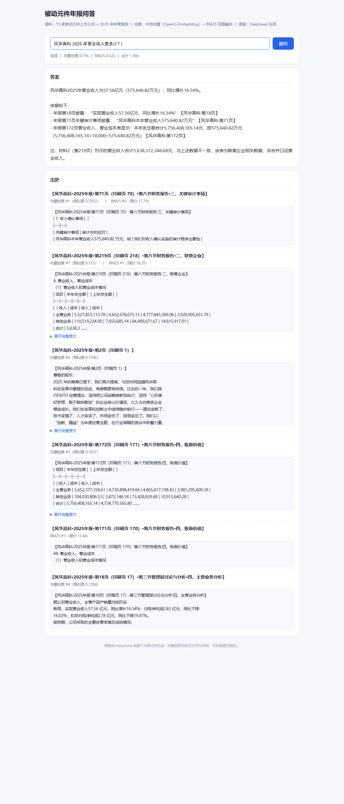

# 被动元件财报问答知识库

用 15 家 A 股被动元件上市公司（风华高科、顺络电子、三环集团、法拉电子、火炬电子等）的
**2025 年年度报告**，建的一个能提问、答案带出处（公司 + 页码）的问答知识库。
「人工智能作业 03（作业 A）」成果：本地向量 + BM25 双路检索，DeepSeek 生成答案。



## 技术路线

1. 从东方财富下载 15 份 2025 年报 PDF（`data/raw/`，约 149 MB，**未入库**）
2. PyMuPDF 提取正文和表格，保留页码标记（`data/clean/text_raw/`，未入库）
3. 清洗页眉页脚 → `data/clean/text/`（**已入库**：15 份，2,967 页，约 370 万字）
4. 切块：每块约 600 字、不跨页、长段留 100 字重叠、表格整表保留 → 7,470 块
5. 建两套索引：本地向量（Qwen3-Embedding-0.6B，CPU 推理）+ BM25
   （`data/clean/index/`，约 66 MB，向量为 7,470 × 1024，**未入库**）
6. 问答页面：向量 top-10 + BM25 top-10 → RRF 融合去重 → top-6 交给 DeepSeek 生成，
   逐条标注出处

## 目录结构

```
scripts/             全部脚本（下节有对照表）
data/codebook/       研究对象底稿：公司清单、文件说明
data/clean/text/     语料：清洗后的 15 份年报文本（已入库）
data/clean/*.csv     下载清单、选定清单（已入库）
outputs/             一页结论（md / pdf）、逐题测试记录、问答页面截图（已入库）
data/raw/            原始 PDF（未入库）
data/clean/text_raw/ 原样提取（未入库）
data/clean/chunks/   切块结果（未入库，可由语料一两分钟内重建）
data/clean/index/    向量与 BM25 索引（未入库，重建需数小时）
logs/                运行日志（未入库）
```

## 安装

- Python ≥ 3.10（本机实测：Windows 11 / Python 3.14）
- 内存建议 ≥ 8 GB（问答服务加载向量模型约占 2.5 GB）
- 全程 CPU 可跑，无需 GPU

```bash
python -m pip install -r requirements.txt
# 国内网络慢可加清华源：-i https://pypi.tuna.tsinghua.edu.cn/simple
```

## 使用前准备

### 1）本地向量模型 Qwen3-Embedding-0.6B

国内网络先设镜像（可选）：`set HF_ENDPOINT=https://hf-mirror.com`

```bash
pip install huggingface_hub
huggingface-cli download Qwen/Qwen3-Embedding-0.6B --local-dir D:\models\Qwen3-Embedding-0.6B
```

然后把 `scripts/build_index.py` 配置区里的 `MODEL_DIR` 改成你的实际路径
（这是仓库里唯一一处需要改的本机绝对路径）。问答服务从
`data/clean/index/index_meta.json` 读模型路径，建索引时自动写入，不用改第二处。

### 2）DeepSeek API 密钥（只走环境变量）

```bat
setx DEEPSEEK_API_KEY 你的密钥
```

密钥只从「进程环境变量 → 注册表环境变量（Windows）」读取，**不写文件、
不下发浏览器、不打印内容**。可选覆盖：`DEEPSEEK_BASE_URL`
（默认 https://api.deepseek.com）、`DEEPSEEK_MODEL`（默认 deepseek-chat）。
没有密钥也能用：检索照常出结果，只有「答案生成」区提示未配置。

## 如何运行（含完整复现）

在项目根目录执行；脚本自动按自身位置定位项目根，缺目录会自动创建：

```bash
python scripts/fetch_sw_industry.py       # ① 抓申万「被动元件」成分股名单（可跳过，名单已附带）
python scripts/fetch_reports.py           # ② 东方财富下载年报 PDF → data/raw/
python scripts/verify_reports.py          # ③ 下载核验（结构 + 内容两层）
python scripts/extract_pdf_text.py        # ④ PyMuPDF 提取 → data/clean/text_raw/（本机约 20 分钟）
python scripts/clean_headers_footers.py   # ⑤ 清洗页眉页脚 → data/clean/text/
python scripts/chunk_corpus.py            # ⑥ 切块 → data/clean/chunks/（7,470 块，一两分钟）
python scripts/build_index.py             # ⑦ 建索引（本机 CPU 约 3 小时，断点续跑）
python scripts/qa_server.py               # ⑧ 起问答页面 → http://127.0.0.1:8765
```

- **只想复现问答效果**：仓库已带 `data/clean/text/`，从 ⑥ 开始跑即可
  （⑥ 秒级；⑦ 是本项目最耗时的一步，中断后重跑会从断点续）。
- Windows 也可以双击 `scripts/run_qa_server.cmd` 启动（自动从 PATH 找
  `python`，找不到就用 `py`）。
- 页面支持带上问题直接打开，如
  `http://127.0.0.1:8765/?q=风华高科2025年营业收入是多少？`

各脚本分工：

| 脚本 | 作用 |
|---|---|
| fetch_sw_industry.py | 用 akshare 抓申万三级「被动元件」成分股 |
| fetch_reports.py | 东财公告接口找年报 → 下载 PDF（去重、跳过已下载） |
| verify_reports.py | 二层核验：PDF 结构（魔数 / md5 / 页数）+ 内容（首页身份核对） |
| extract_pdf_text.py | PyMuPDF 逐页提取正文与表格，每页标物理页码 + 印刷页码 |
| clean_headers_footers.py | 删页眉页脚（按行内容判重，不按位置——防误删伸进表格的正文） |
| chunk_corpus.py | 切块：约 600 字/块、不跨页、长段 100 字重叠、表格原子化 |
| text_tokenize.py | 分词（jieba；数字整串保留），建索引与查询共用同一套 |
| build_index.py | 建向量索引（Qwen3-Embedding，fp32/CPU）与 BM25 索引 |
| qa_server.py | Flask 问答服务（端口 8765；密钥只读环境变量） |
| qa_page.html | 前端页面（提问 / 答案 / 出处 三区） |
| run_qa_server.cmd | Windows 双击启动器（从 PATH 找 python / py） |
| docx_to_md.py | 附赠工具：docx → markdown（逐题测试记录就是这么转的） |

## 测试结果与结论

10 道题实测：单公司数据题 **4/4 全对**；单公司文字题 1 对、1 错、1 部分对；
跨公司全景题 **0/3**（检索每次只召回 top-k 个块，无法遍历全库汇总）。

- [逐题测试记录（10 题逐题拆解）](outputs/逐题测试记录.md)
- [一页结论（PDF，1 页）](outputs/一页结论.pdf)

**结论**：纯向量 + BM25 的 RAG 适合「单公司、数据型、答案集中」的问题；
「跨公司、文字型、答案散落」的问题需要知识图谱，或调整切块策略。

## 数据与版权

- 年报 PDF 来源：东方财富（转载方；法定披露渠道为巨潮资讯 / 交易所网站）。
- 年报版权归各上市公司所有。本仓库只保留清洗后的文本用于学习研究；
  原始 PDF、切块结果、向量索引均未入库（体积原因，且均可按上面链路重建）。
